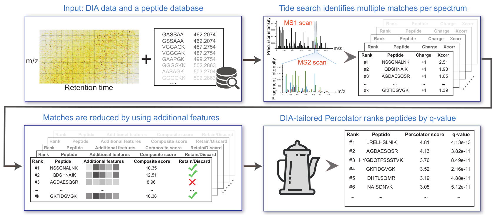

# DIAmeter : Matching peptides to data-independent acquisitionmass spectrometry data

This repo contains the python implementations of the manuscript titled "DIAmeter : Matching peptides to data-independent acquisitionmass spectrometry data". 
It is worth noting that the code will be integrated into [Crux mass spectrometry analysis toolkit](http://crux.ms) soon. 
Details are listed below:
 

1.  Construct a bipartite graph between the observed DIA data and the list of theoretical precursors (i.e., charged peptides) in the database using a DDA search engine (i.e., Tide).
2.  Compute a series of features for edge in the graph, and eliminate some edges based upon a composite scoreaggregated from these features.
3.  Run the remaining edges, with associated features, through a modified version of the Percolator algorithm.
4.  Use target-decoy competition at the peptide level to estimate a q-value (i.e., the minimal FDR threshold atwhich a given peptide is accepted) for each ranked peptide.
 

# Notice
The Python version of DIAmeter is no longer supported. Please use the actively maintained version integrated into the Crux mass spectrometry analysis toolkit, available at https://crux.ms/.

# Requirements
Python2.7, 

# How to run?

#### 1. Bipartite graph construction
You can use xcorrPipeline.py for processing fixed-window acquisition data and xcorrPipeline_var.py for processing variable-window acquisition data (in the .mzXML format).

#### 2. Feature calculation, edge filtering, ranking, and postprocessing
You can use diasearchPipeline.py for the remaining tasks

# Contact
If you have any questions or suggestions about the code or manuscript, please do not hesitate to contact Yang Lu(`ylu465@uw.edu`)
and Prof. William Noble(`william-noble@uw.edu`). 

# Citation
Lu, Y. Y., Bilmes, J., Rodriguez-Mias, R. A., Villén, J., & Noble, W. S. (2021). DIAmeter: matching peptides to data-independent acquisition mass spectrometry data. Bioinformatics, 37(Supplement_1), i434-i442.
